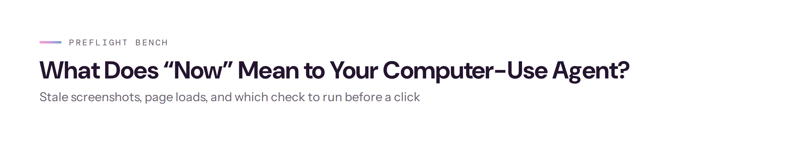
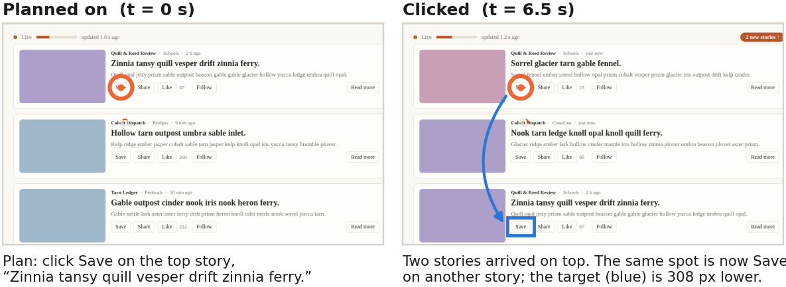

<picture>
  <source media="(prefers-color-scheme: dark)" srcset="assets/banner-dark.png">
  
</picture>

<p align="center">
  <a href="paper/paper.pdf"></a>
  <a href="LICENSE"></a>
  <a href="docs/DATA_CARD.md"></a>
  <a href="docs/"></a>
  
</p>

Code and data for the paper *What Does “Now” Mean to Your Computer-Use Agent? Stale screenshots, page loads, and which check to run before a click* (Srinivasan, 2026): the benchmark generator, the checks, the real-page measurement code, the preregistrations and the results.

A computer-use agent captures a screenshot, plans for several seconds, and then clicks at a position on the screen. If the page changes during that interval, the click lands on an unintended element. Prior work treats the planning interval as the source of risk. This study measures when planned clicks become stale on real pages and evaluates which form of perception should verify the screen immediately before a click.

## Findings

1. **The risk lies in page loading; planning time has little effect.** On 31 public web pages, 0.4% of clicks planned on a fully loaded page became stale within 30 seconds. Within one second of a page opening, 17% did. Waiting until network activity stops (a median of 1.2 s) reduces this to 0.5%. The wait rules of eight of ten widely used open-source agents leave more than 1% of clicks stale.
2. **Pixels verify *where*; models verify *what*.** A pixel comparison at the target detected 82% of stale clicks at a 4% false-alarm rate in 0.3 s, matching Claude Opus 5.5 with one third of the false alarms and one eighth of the latency. Small vision-language models (2B–4B) were unreliable at detecting moved targets, yet a 4B model matched Opus in judging whether the previous action succeeded.
3. **A break-even formula predicts when a check is worth its cost.** Its check-or-skip decisions agreed with held-out data in 95% of cases.

<p align="center">
  
  <br><sub>A stale click from the benchmark. The agent plans to save the top story; two new stories arrive while it plans, and its click saves a different one.</sub>
</p>

## Repository contents

| Folder | What it does |
|---|---|
| `pages_full/` | Six synthetic web pages that keep moving (a form, a market dashboard, a news feed, a shared document, a map, a drawing board). Self-contained HTML, no network. |
| `generator/` | Renders the pages in Chromium with a paused clock, seeds a change between "plan" and "click" (target moved, covered, removed, a dialog, a slow load, or nothing) and records the true answer from the page itself. `make_full.py` is the benchmark generator. |
| `anchored/` | The pixel check: masks pixels that move on their own, re-finds the target, checks for covers and dialogs. |
| `models/` | The model checks (Qwen3-VL 2B/4B, SmolVLM2, Florence-2, Claude Haiku 5.5 and Opus 5.5) and their prompts. |
| `bench/score.py` | Scores a submission file against the labels. |
| `harness/` | Scoring, tuning, the break-even formula, and the code for every table and figure. |
| `live/` | The live agent loop (a Claude planner clicking on the moving pages, with and without the check). |
| `realsite/` | The read-only real-page collector (31 public pages, no clicks, at least 10 s between loads per site) and the ten agents' wait rules. |
| `docs/` | Preregistrations (each frozen before its data existed), the data card, third-party notes, and the formula's derivation. |
| `results/` | Results write-ups, tables and raw model decisions. |
| `paper/` | Paper source, figures and PDF. |

## Quick start

Requires Python 3.11 or 3.12 and [uv](https://docs.astral.sh/uv/).

```bash
uv sync
uv run playwright install chromium

# Generate a sample of 40 benchmark pairs (a few minutes on a laptop)
uv run python -m generator.make_full --only 40 --part action

# Run the pixel check on the sample with the paper's frozen thresholds
uv run python quickstart.py
```

Each pair contains four screenshots (two at planning time, two 6.5 s later), the box the agent planned to click, and the ground truth recorded from the page at the moment of the click.

### Regenerate the full benchmark

```bash
PREFLIGHT_REGENERATE=1 uv run python -m generator.make_full --workers 4
```

This writes 4,608 action pairs and 3,600 "did it work?" pairs to `data/full/`. Layout variants 0–1 are the tuning split (labels included); variants 2–3 are the test split, whose labels go to `private/`. Rendering is deterministic for a given Chromium build; the paper used Playwright 1.64.1 (Chromium build 1248). In the original study the data was generated only after the preregistration was frozen; the `PREFLIGHT_REGENERATE` switch exists so a public clone can rebuild it.

### Reproduce the paper's numbers

```bash
uv run python -m harness.full_checks features dev && uv run python -m harness.full_checks features test
uv run python -m harness.full_checks decisions test    # pixel checks and PUSV baselines
uv run python -m harness.full_results all              # Table 1 and the replay
uv run python -m harness.ext_inequality                # the break-even formula against the replay
uv run python -m harness.agent_rules                   # agent wait rules (needs your own real-page run)
```

Model checks need a GPU for the open models (`colab/`) and an Anthropic API key in `PREFLIGHT_API_KEY` for the hosted ones. Raw model answers from the study are in `results/` so the tables can be rebuilt without calling any model.

### Measure real pages yourself

`realsite/collect_add.py` visits public pages read-only and records how often planned clicks become stale under different wait rules. Use only pages you are allowed to load, keep the delay between loads, and keep screenshots private: they contain third-party content. The study's own real-page screenshots are not released.

## Preregistration

The study ran under four preregistrations, each committed and tagged before its data was collected (`prereg-v1`, `prereg-ext-v1`, `prereg-add-v1`, `prereg-agents-v1`), after two preregistered pilot waves. This public copy is a clean snapshot; the documents in `docs/` keep their original freeze dates. Of eleven preregistered hypotheses, four held and seven were refuted; all are reported in the paper.

## Citation

```bibtex
@article{srinivasan2026preflight,
  author = {Srinivasan, Vasundra},
  title  = {What Does ``Now'' Mean to Your Computer-Use Agent? Stale Screenshots, Page Loads, and Which Check to Run Before a Click},
  year   = {2026},
  url    = {https://github.com/multimodal-ai-engineering/preflight-bench}
}
```

## License

Code: MIT. Benchmark pages and generated data: CC BY 4.0. All page content is invented. PUSV is reimplemented from its paper's text only; see `docs/THIRD_PARTY.md`.

This is independent research done outside any employment, with no funding and no non-public information.
