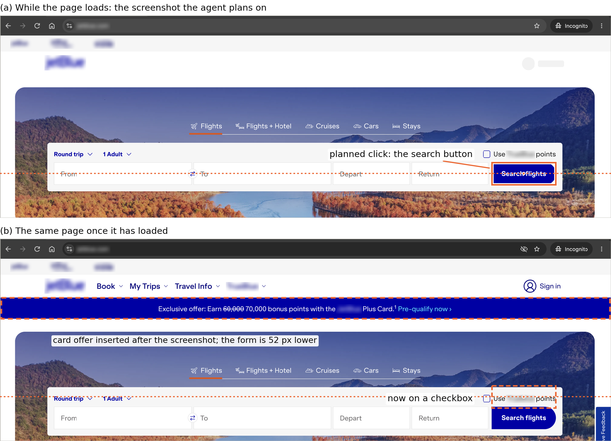
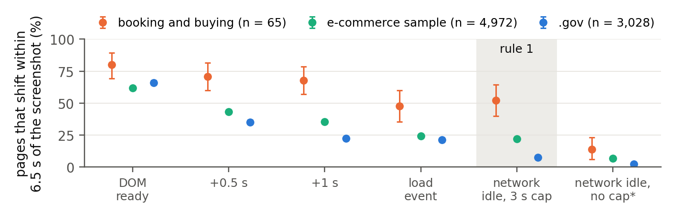

<picture>
  <source media="(prefers-color-scheme: dark)" srcset="docs/assets/banner-dark.png">
  
</picture>

<p align="center">
  <a href="LICENSE"></a>
  <a href="docs/DATA_CARD.md"></a>
  <a href="docs/"></a>
  
</p>

Code and data for the paper *What Does “Now” Mean to Your Computer-Use Agent? Stale screenshots, page loads, and which check to run before a click* (Srinivasan, 2026): the benchmark generator, the checks, the real-page measurement code, the preregistrations and the results.

A computer-use agent captures a screenshot, plans for several seconds, and then clicks at a position on the screen. If the page changes during that interval, the click lands on an unintended element. Prior work treats the planning interval as the source of risk. This study measures when planned clicks become stale on real pages and evaluates which form of perception should verify the screen immediately before a click.

## Findings

1. **The risk lies in page loading; planning time has little effect.** On 31 public web pages, 0.4% of clicks planned on a fully loaded page became stale within 30 seconds. Within one second of a page opening, 17% did. Waiting until network activity stops (a median of 1.2 s) reduces this to 0.5%. The wait rules of eight of ten widely used open-source agents leave more than 1% of clicks stale.
2. **Commercial pages keep loading after the wait.** Measured from the HTTP Archive's public crawl, without visiting any site: 15% of 65 desktop booking and buying home pages reached network idle within 3 s of DOM-ready, against 63% of 3,028 .gov home pages. After a network-idle wait capped at 3 s, 52% of the booking pages shifted their layout within 6.5 s, against 8% of the .gov pages (61% against 26% among pages recorded in full). On these pages the check before an irreversible click matters more. Mobile home pages did not show the same gap.
3. **Pixels verify *where*; models verify *what*.** A pixel comparison at the target detected 82% of stale clicks at a 4% false-alarm rate in 0.3 s, matching Claude Opus 5.5 with one third of the false alarms and one eighth of the latency. Small vision-language models (2B–4B) were unreliable at detecting moved targets, yet a 4B model matched Opus in judging whether the previous action succeeded.
4. **A break-even formula predicts when a check is worth its cost.** Its check-or-skip decisions agreed with held-out data in 95% of cases.

<p align="center">
  
  <br><sub>One airline's home page in a desktop Chrome Incognito window, in screenshots taken by hand on 28 October 2026; brand names are blurred. (a) A screenshot taken while the page loads: the search form is complete, and an agent planning on it would click the search button (the dotted line marks its height). (b) The same page once it has loaded: a credit-card offer was inserted under the menu and pushed the form down 52 px, so the planned point is on a checkbox that switches the search to loyalty points. The HTTP Archive crawl of this page on 1 October recorded the timing: a network-idle wait capped at 3 s ends at 3.5 s, the layout shifts 1.3 s later, and the network goes quiet only at 8.1 s. Figure 1 of the paper, shown larger here.</sub>
</p>

## Repository layout

```
preflight-bench/
├── benchmark/    the moving web pages the benchmark is rendered from
├── data/         benchmark metadata and labels (screenshots are regenerated, see below), and per-page crawl rows
├── src/          all code
│   ├── generator/   renders the pages and records the true answer for every pair
│   ├── anchored/    the pixel check
│   ├── models/      the model checks and their prompts
│   ├── bench/       scoring a submission against the labels
│   ├── harness/     tuning, the break-even formula, every table and figure
│   ├── live/        the live agent loop
│   ├── realsite/    the read-only real-page collector and the ten agents' wait rules
│   ├── commercial/  commercial pages measured from the HTTP Archive crawl in BigQuery
│   └── colab/       GPU runners for the open models
├── results/      write-ups, tables, raw model answers and figures
└── docs/         preregistrations, data card, third-party notes
```

## Quick start

Requires Python 3.11 or 3.12 and [uv](https://docs.astral.sh/uv/).

```bash
uv sync
uv run playwright install chromium

# Generate a sample of 40 benchmark pairs (a few minutes on a laptop)
uv run python -m generator.make_full --only 40 --part action

# Run the pixel check on the sample with the paper's frozen thresholds
uv run python quickstart.py
```

Each pair contains four screenshots (two at planning time, two 6.5 s later), the box the agent planned to click, and the ground truth recorded from the page at the moment of the click.

### Regenerate the full benchmark

```bash
PREFLIGHT_REGENERATE=1 uv run python -m generator.make_full --workers 4
```

This writes 4,608 action pairs and 3,600 "did it work?" pairs to `data/full/`. Layout variants 0–1 are the tuning split (labels included); variants 2–3 are the test split, whose labels go to `private/`. Rendering is deterministic for a given Chromium build; the paper used Playwright 1.64.1 (Chromium build 1248). In the original study the data was generated only after the preregistration was frozen; the `PREFLIGHT_REGENERATE` switch exists so a public clone can rebuild it.

### Reproduce the paper's numbers

```bash
uv run python -m harness.full_checks features dev && uv run python -m harness.full_checks features test
uv run python -m harness.full_checks decisions test    # pixel checks and PUSV baselines
uv run python -m harness.full_results all              # Table 1 and the replay
uv run python -m harness.ext_inequality                # the break-even formula against the replay
uv run python -m harness.agent_rules                   # agent wait rules (needs your own real-page run)
```

Model checks need a GPU for the open models (`src/colab/`) and an Anthropic API key in `PREFLIGHT_API_KEY` for the hosted ones. Raw model answers from the study are in `results/` so the tables can be rebuilt without calling any model.

### Measure real pages yourself

`src/realsite/collect_add.py` visits public pages read-only and records how often planned clicks become stale under different wait rules. Use only pages you are allowed to load, keep the delay between loads, and keep screenshots private: they contain third-party content. The study's own real-page screenshots are not released.

### Measure commercial pages without visiting them

`src/commercial/` measures how long home pages keep loading and moving after an agent's wait, from the HTTP Archive's public crawl in BigQuery, so no commercial site is visited. The desktop query outputs from the study are in `data/commercial/`, so the analysis reruns without BigQuery; `src/commercial/README.md` has the commands, and the steps for running the queries on your own GCP project with a hard byte cap on every query.

<p align="center">
  
  <br><sub>Share of desktop home pages whose layout shifts within 6.5 s of the screenshot, by wait rule (95% intervals). Unrecorded time counts as no shift, so each point is a lower bound.</sub>
</p>

## Preregistration

The study ran under five preregistrations, each committed and tagged before its data was collected or, for the crawl, read (`prereg-v1`, `prereg-ext-v1`, `prereg-add-v1`, `prereg-agents-v1`, `prereg-com-v1`), after two preregistered pilot waves. This public copy is a clean snapshot; the documents in `docs/` keep their original freeze dates. Paths in those documents refer to the study's original layout, where each folder now under `src/` sat at the top level (for example, `generator/` is now `src/generator/`), and `pages_full/` is now `benchmark/pages_full/`; `commercial/` is now `src/commercial/`, with its results in `results/commercial/`. Of fourteen preregistered hypotheses, six held and eight were refuted; all are reported in the paper.

## Citation

```bibtex
@article{srinivasan2026preflight,
  author = {Srinivasan, Vasundra},
  title  = {What Does ``Now'' Mean to Your Computer-Use Agent? Stale Screenshots, Page Loads, and Which Check to Run Before a Click},
  year   = {2026},
  url    = {https://github.com/multimodal-ai-engineering/preflight-bench}
}
```

## License

Code: MIT. Benchmark pages and generated data: CC BY 4.0. All benchmark page content is invented. The per-page rows in `data/commercial/` are derived from the [HTTP Archive](https://httparchive.org) crawl, whose maintainers ask for attribution. PUSV is reimplemented from its paper's text only; see `docs/THIRD_PARTY.md`.

This is independent research done outside any employment, with no funding and no non-public information.
